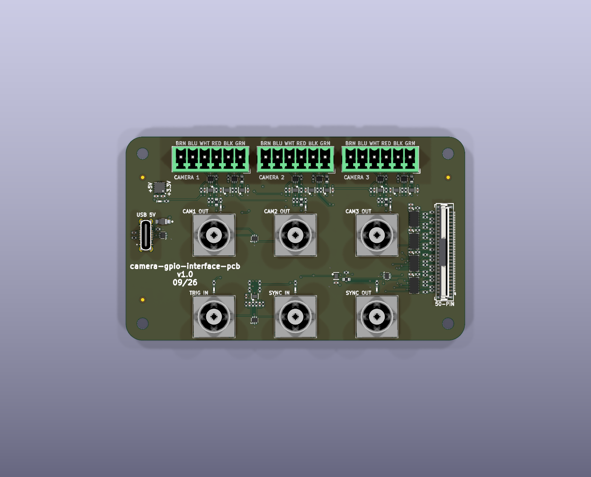
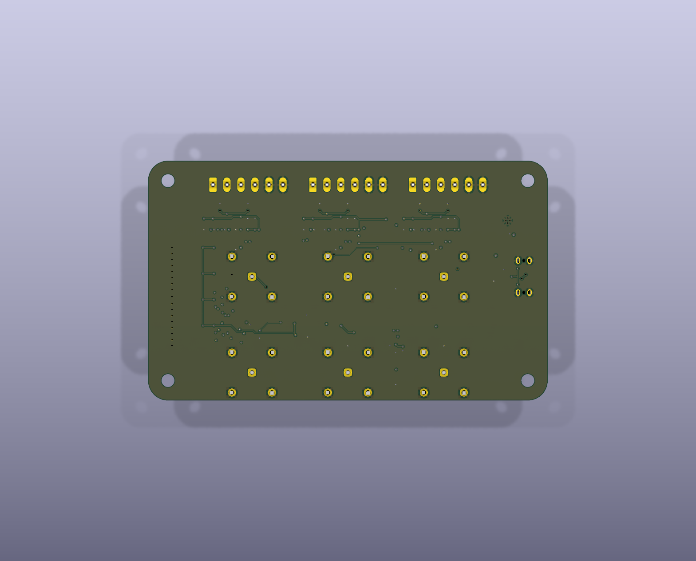
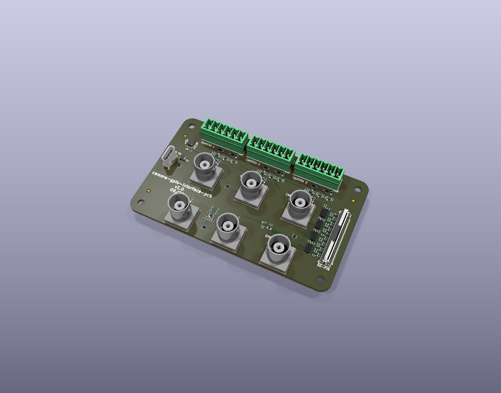
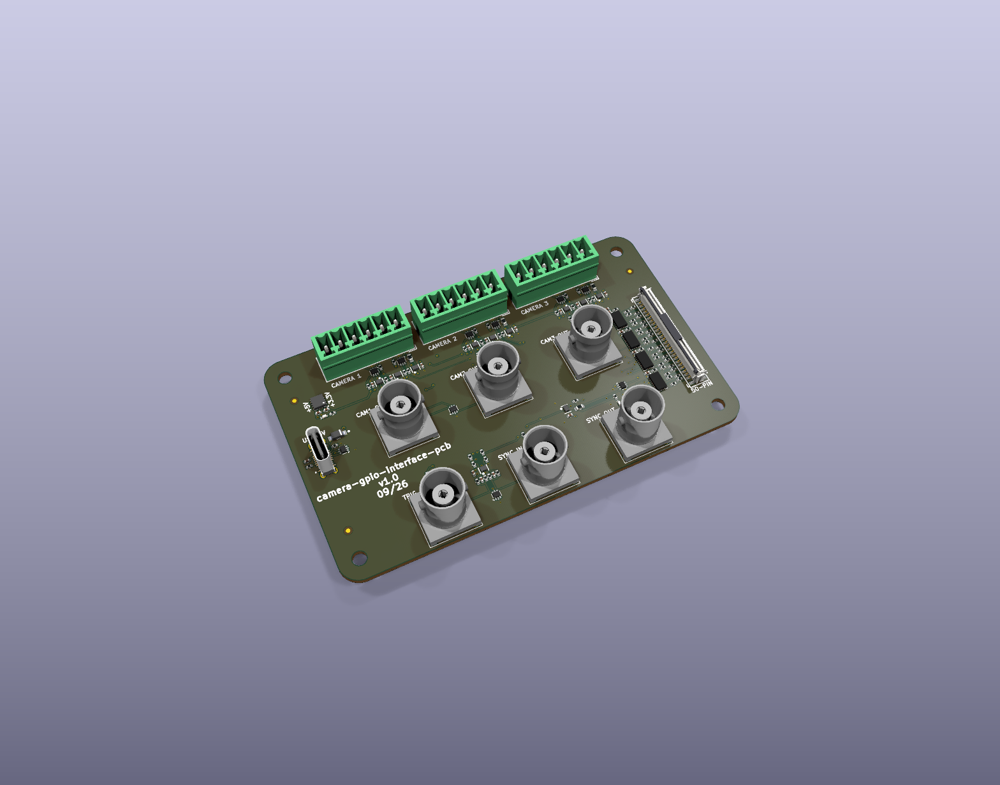
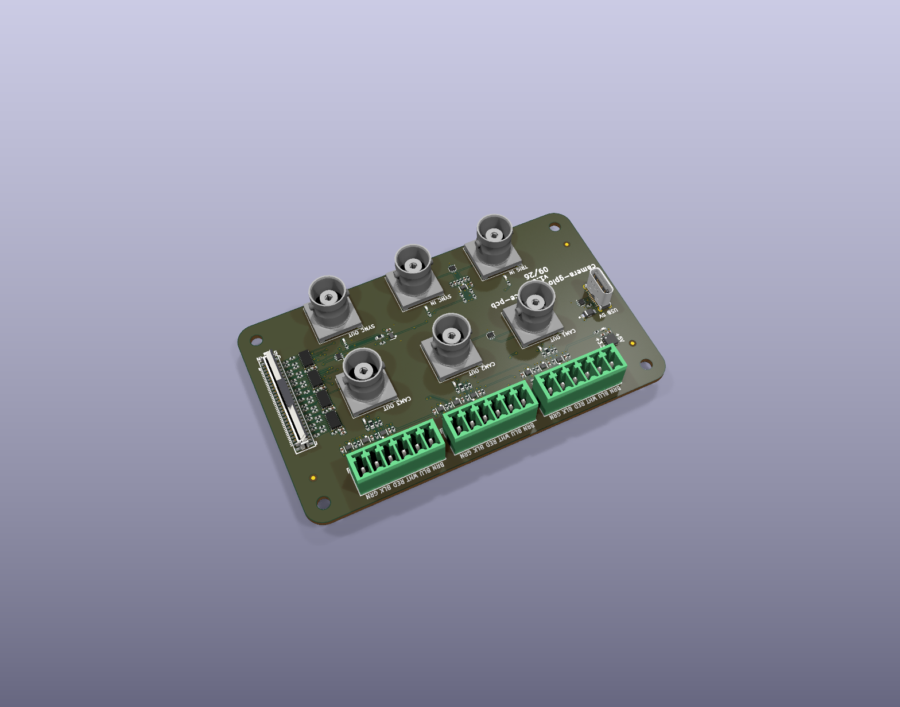
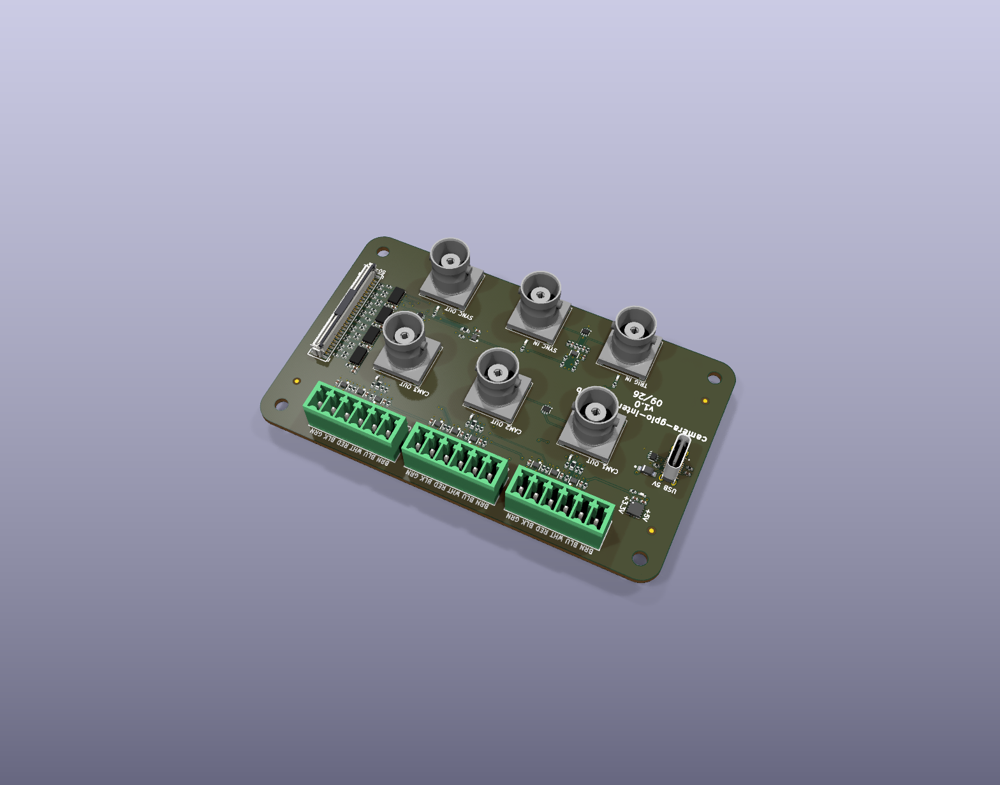
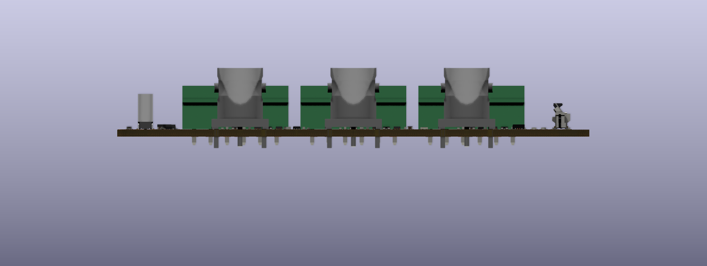
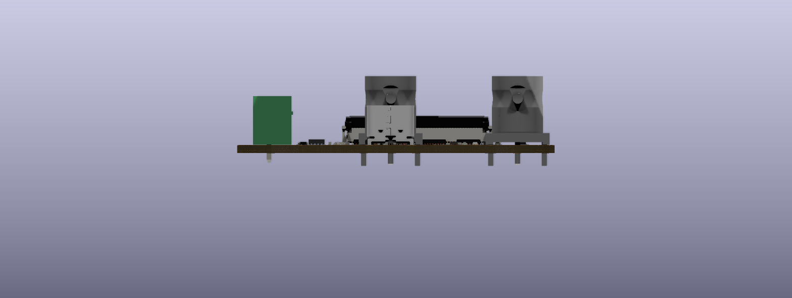

# camera-gpio-interface-pcb — Generated Board Documentation

Everything in this directory is generated by `orb-weaver-kicad-docs` from the
KiCad sources. Do not edit it by hand; run `make docs` instead.

- KiCad `10.0.6`
- Board `c393574f3046`

## Board At A Glance

| Property | Value |
| --- | --- |
| Outline | 100.0 × 60.0 mm, 5.0 mm corner radius |
| Thickness | 1.6 mm |
| Copper layers | 4 |
| Mounting holes | 4 × 3.2 mm |
| Connectors and controls | 11 |
| Bill of materials | 26 distinct parts, 151 placements |

## Assembled Board

### Top, straight down

### Bottom, straight down

### Isometric from the front left

### Isometric from the front right

### Isometric from the rear left

### Isometric from the rear right

### Front elevation, for connector heights

### Left elevation, for connector heights

## Documents

| Document | File |
| --- | --- |
| Schematic, all sheets, PDF | [camera-gpio-interface-pcb-schematic.pdf](schematic/camera-gpio-interface-pcb-schematic.pdf) |
| Schematic sheets, SVG (11) | [schematic/](schematic/) |
| Assembly view, top | [assembly-top.svg](layout/assembly-top.svg) |
| Assembly view, bottom | [assembly-bottom.svg](layout/assembly-bottom.svg) |
| Assembled board, STEP, for FreeCAD | [camera-gpio-interface-pcb-assembled.step](3d/camera-gpio-interface-pcb-assembled.step) |
| Bill of materials | [table](bom/camera-gpio-interface-pcb-bom.md) · [CSV](bom/camera-gpio-interface-pcb-bom.csv) |
| Board dimensions and stackup | [board-dimensions.md](mechanical/board-dimensions.md) |
| Board geometry, machine readable | [board-geometry.json](mechanical/board-geometry.json) |
| Mounting holes | [mounting-holes.csv](mechanical/mounting-holes.csv) |
| Connector locations | [connectors.csv](mechanical/connectors.csv) |

### Enclosure Reference

Millimetres from the **centre of the board outline**, X right and Y up,
looking at the top of the board. Extents are the part's courtyard, which is
what a panel cutout has to clear. Full tables in [board-dimensions.md](mechanical/board-dimensions.md).

**Mounting holes**

| Ref | X (mm) | Y (mm) | Drill (mm) |
| --- | --- | --- | --- |
| H101 | -45.0 | 25.0 | 3.2 |
| H102 | 45.0 | 25.0 | 3.2 |
| H103 | 45.0 | -25.0 | 3.2 |
| H104 | -45.0 | -25.0 | 3.2 |

**Connectors and controls**

| Ref | Part | X (mm) | Y (mm) | Rot | Extent X (mm) | Extent Y (mm) |
| --- | --- | --- | --- | --- | --- | --- |
| J301 | HL-BNC-KHDA | -24.0 | -23.0 | 0.0 | -30.5 to -17.5 | -29.5 to -16.5 |
| J302 | HL-BNC-KHDA | 0.0 | -23.0 | 0.0 | -6.5 to 6.5 | -29.5 to -16.5 |
| J401 | HL-BNC-KHDA | 24.0 | -23.0 | 0.0 | 17.5 to 30.5 | -29.5 to -16.5 |
| J402 | HL-BNC-KHDA | -24.0 | 1.0 | 0.0 | -30.5 to -17.5 | -5.5 to 7.5 |
| J403 | HL-BNC-KHDA | 0.0 | 1.0 | 0.0 | -6.5 to 6.5 | -5.5 to 7.5 |
| J404 | HL-BNC-KHDA | 24.0 | 1.0 | 0.0 | 17.5 to 30.5 | -5.5 to 7.5 |
| J501 | FH12-50S-0.5SVA(54) | 44.0 | -4.0 | 270.0 | 41.2 to 46.8 | -18.75 to 10.75 |
| J701 | TBH-1x06-3.5mm | -25.0 | 24.0 | 180.0 | -36.7 to -13.3 | 19.25 to 27.5 |
| J901 | USB-C | -44.0 | 1.0 | 90.0 | -46.31 to -41.69 | -4.05 to 6.05 |
| J1201 | TBH-1x06-3.5mm | 0.0 | 24.0 | 180.0 | -11.7 to 11.7 | 19.25 to 27.5 |
| J1401 | TBH-1x06-3.5mm | 25.0 | 24.0 | 180.0 | 13.3 to 36.7 | 19.25 to 27.5 |

