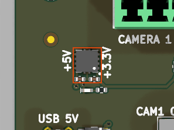

# 5v_to_3v3_tps73733

<!-- Generated by orb-weaver-kicad-board-docs from board-manifest.yaml; do not edit. -->

Block `orb_weaver_private:5v_to_3v3_tps73733` placed in `/power` of **camera-gpio-interface-pcb**. Clean 3.3 V linear regulator from a 5 V input rail using the TI TPS73733 fixed 3.3 V 1 A LDO.

|  |  |
| --- | --- |
| Lifecycle | routed |
| Family | none (a private block) |
| Placement | anchor (-40, -15) mm, rotation 180°, front side |
| Sheet | `5v_to_3v3_tps73733.kicad_sch`; sheet pins: the library's arrangement |
| Drawing | [camera-gpio-interface-pcb-power-5v_to_3v3_tps73733.svg](../schematic/camera-gpio-interface-pcb-power-5v_to_3v3_tps73733.svg) |

## On the Board

Block 4 of the [board view](../board-view.md): 3.9 × 4.9 mm on the top side, its centre 40.0 mm left of and 14.5 mm above the board centre (X right, Y up, as the enclosure tables); 3 footprints. The picture is the top render clipped around the block, the rectangle the extent of its footprints' courtyards.

## Description

Clean 3.3 V linear regulator from a 5 V input rail using the TI TPS73733 fixed 3.3 V 1 A LDO. Intended for MCU, RP2040, TMC logic, encoder interface, and other low-voltage digital circuitry.

## Ports

The brief's shape, edge, class and meaning for each port, then what the board wires it to.

| Port | Shape | Edge | Class | Wired to | Board net | Board class | GPIO | Meaning | On this board |
| --- | --- | --- | --- | --- | --- | --- | --- | --- | --- |
| `+3.3V` | passive | east | PWR_3V3_LOCAL | `+3.3V` | `/+3.3V` | PWR_3V3_NARROW |  | Regulated output, 3.3 V fixed. | The only logic rail, from the TPS73733 on the power sheet; always on while USB is present, as the InstrumentPort block requires |
| `+5V` | passive | west | PWR_5V_LOCAL | `+5V` | `/+5V` | PWR_5V_NARROW |  | Input rail; also drives EN, so the regulator is on whenever it is present. | VBUS after the USB block's Schottky (+5V_USB in the design record): the Line 0 pull-ups and every ESD array's clamp reference |
| `GND` | passive | west | PWR_RETURN_LOCAL | `GND` | `/GND` | PWR_RETURN_LOCAL |  | Common return; regulator ground pin and thermal pad. | Board ground; every BNC shell and camera pins 5 and 6 |

## Parts

As placed on the board's sheet; 3 of 3 paired with the brief's references by symbol identity, the rest given the brief's role where the internal part has one, else the catalog's role slug; the placement is the `Placement` field of the board's symbol, else of the library's (D38); the manufacturer part and the LCSC number are the board's BOM's.

| Reference | Brief | Part | Value | Role | Placement | Manufacturer part | LCSC | DNP |
| --- | --- | --- | --- | --- | --- | --- | --- | --- |
| `C1001` | `C14001` | `OW-PASS-CL05A105KL5NRNC` | 1uF | Input bypass | beside U1001.5 (EN), on +5V | CL05A105KL5NRNC | [C307413](https://www.lcsc.com/product-detail/C307413.html) |  |
| `C1002` | `C14002` | `OW-PASS-CL05A105KL5NRNC` | 1uF | Output capacitor | beside U1001.1 (OUT), on +3.3V | CL05A105KL5NRNC | [C307413](https://www.lcsc.com/product-detail/C307413.html) |  |
| `U1001` | `U14001` | `OW-PWR-TPS73733QDRBRQ1` | TPS73733QDRBRQ1 | Fixed 3.3 V LDO |  | [TPS73733QDRBRQ1](https://www.ti.com/lit/ds/symlink/tps737-q1.pdf) | [C523768](https://www.lcsc.com/product-detail/C523768.html) |  |

## Operating Notes

- Signal path: +5V -> U14001 (IN, pin 8) -> +3.3V (OUT, pin 1). EN (pin 5) is tied to IN, so the regulator is on whenever +5V is present; there is no enable control inside this block.
- NR (pin 3) is left open: no noise-reduction capacitor is fitted. GND (pin 4) and the thermal pad (pin 9) return to GND.
- C14001 (1 uF) bypasses the input, C14002 (1 uF) is the output capacitor; both are the catalog 0402 1 uF part. The rail is rated by the TPS73733 (fixed 3.3 V, 1 A class per the catalog description); derate for the board's actual load and dropout.

## Placement and Routing

### Regulator and bypass

`C14001`, `U14001`, `C14002`

U14001 regulates +5V to +3.3V with EN tied to IN. C14001 bypasses IN to GND, C14002 holds OUT to GND; NR is open.

- Place: Place C14001 at pins 8 and 4 and C14002 at pins 1 and 4 with short local ground returns; tie the thermal pad to GND copper.
- Route: +5V and +3.3V carry the rail classes (PWR_5V_LOCAL, PWR_3V3_LOCAL); the GND return of the pad is the regulator's heat path as well.

## Library Identity

|  |  |
| --- | --- |
| Block | `orb_weaver_private:5v_to_3v3_tps73733` |
| Resolution | the placed id is in the library |
| Brief | `design_blocks/orb_weaver_private.kicad_blocks/5v_to_3v3_tps73733.kicad_block/5v_to_3v3_tps73733.brief.yaml`, the block's brief |
| Published sheet | `d047d03bb7b59ea0` |
| Published PCB | `7de227e948431743` |
| Source lock | symbol snapshot `1238ec2a0373421b`, published 2026-10-14 |
| Placed sheet | `93e1c617af6f6baa`: matches the brief: its 3 parts by internal part, every port by name and shape; the file is the board's copy under its own designators |
| Netlist check | ok on 2026-10-15: every pin on the brief's net; 3 identity records differ, the board's own instances |

