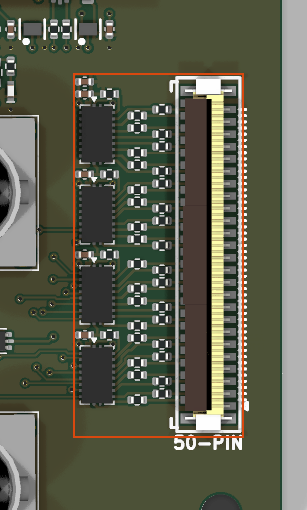

# instrument_port_digital_50_dut_ffc_boundary_vertical

<!-- Generated by orb-weaver-kicad-board-docs from board-manifest.yaml; do not edit. -->

Block `orb_weaver_private:instrument_port_digital_50_dut_ffc_boundary_vertical` placed in `/` of **camera-gpio-interface-pcb**. DUT-side InstrumentPort-Digital-50 with integrated read-only buffering, on a VERTICAL, top-entry 50-contact ZIF connector: Hirose FH12-50S-0.5SVA(54), OW-CONN-FH12-50S-0-5SVA-54, LCSC C597991, 0.5mm pitch, symbol Conn_01x50, footprint orb_weaver_connectors:Hirose_FH12-50S-0.5SVA_1x50-4MP_P0.5mm_Vertical; the four mechanical lands are unnumbered pads and carry no net.

|  |  |
| --- | --- |
| Lifecycle | routed |
| Family | none (a private block) |
| Placement | anchor (44, 4) mm, rotation 270°, front side |
| Sheet | `instrument_port_digital_50_dut_ffc_boundary_vertical.kicad_sch`; sheet pins: the board's own arrangement |
| Drawing | [camera-gpio-interface-pcb-instrument_port_digital_50_dut_ffc_boundary_vertical.svg](../schematic/camera-gpio-interface-pcb-instrument_port_digital_50_dut_ffc_boundary_vertical.svg) |

## On the Board

Block 5 of the [board view](../board-view.md): 13.7 × 29.5 mm on the top side, its centre 39.9 mm right of and 4.0 mm below the board centre (X right, Y up, as the enclosure tables); 46 footprints. The picture is the top render clipped around the block, the rectangle the extent of its footprints' courtyards.

## Description

DUT-side InstrumentPort-Digital-50 with integrated read-only buffering, on a VERTICAL, top-entry 50-contact ZIF connector: Hirose FH12-50S-0.5SVA(54), OW-CONN-FH12-50S-0-5SVA-54, LCSC C597991, 0.5mm pitch, symbol Conn_01x50, footprint orb_weaver_connectors:Hirose_FH12-50S-0.5SVA_1x50-4MP_P0.5mm_Vertical; the four mechanical lands are unnumbered pads and carry no net. Thirty-two channels through four SN74LV541ARKSR octal buffers (OW-MISC-SN74LV541ARKSR, C7364695, symbol orb_weaver_misc:SN74LV541ARKSR, footprint orb_weaver_smd:Texas_RKS0020A_VQFN-20-1EP_2.5x4.5mm_P0.5mm_EP1x3mm, exposed pad 21 to GND), grouped DIG0-7 / DIG8-15 / DIG16-23 / DIG24-31 to match the 13-contact octet windows. The 541 is flow-through: input pin p pairs with output pin 20-p, A1(2) to Y1(18) through A8(9) to Y8(11). DIRECTION IS A HARDWARE PROPERTY: DUT to instrument only. The cable carries no supply, no voltage reference, no enable and no stimulus, and nothing in this block may be driven by the instrument. PIN MAPPING IS THE CONTRACT'S DUT TABLE AND IS NOT MIRRORED: channel n lands on pin 2 + n + floor(n/2) + floor(n/16), so DIG0 is pin 2 and DIG31 is pin 49, with all 18 grounds on pins 1, 4, 7, 10, 13, 16, 19, 22, 25, 26, 29, 32, 35, 38, 41, 44, 47 and 50. THE MIRROR LIVES ON THE ADAPTER, NOT HERE. instrument_port_digital_50_adapter_ffc_boundary_vertical is pre-mirrored to 51-n so that the expected reversing assembly - same-side Type A FFC with a vertical FH12 at both ends, connectors rotated 180 degrees - delivers DIGn to DIGn. Mirroring both ends cancels and channels arrive as DIG31-n. The ground pattern is palindromic under 51-n, so a mirrored map lands every ground identically and every net stays driven and terminated: ERC, DRC and design_block_tools.py check are ALL BLIND to this error, and only a pin-by-pin netlist comparison or continuity on the real cable catches it. Per-output source damping is 100 ohms, OW-PASS-0402WGF1000TCE. That value is chosen as the smallest standard one that bounds a hard short to ground inside the LV541A's +/-35mA output absolute maximum even crediting the driver with zero impedance (3.3V/100R = 33mA); 68R gives 49mA, 47R gives 70mA, and the legacy 33R gives 100mA. It is NOT short-circuit protection and does not cover every fault. DEFAULT-ENABLED BY HARDWARE, AND THERE IS NO DISABLE AT ALL: both active-low OE inputs of each package share one net held low by a single 10k pull-down - R39001 through R39004, one per package - so observation works with the MCU held in reset, unprogrammed or unable to boot, and the port cannot be muted without desoldering. There is no manual jumper, no firmware link and no OE port. The owning contract was relaxed on 2026-09-15 from requiring manual disabling to permitting none, so this conforms; the reasoning and the retained future option are in kicad-libs/docs/digital-instrument-port-design-blocks.md under 'No disable control, and why'. DO NOT re-add a control as an oversight fix. Shared 10k is verified against aggregate leakage: 2 x 5uA max gives 0.1V against a 0.99V VIL. If a noise investigation ever needs a mute, detaching the FFC bounds the cable's contribution but NOT the buffers', which keep switching into their board-side traces and damping resistors; lift the 100R resistors on the suspect channels instead. SUPPLY FROM THE BOARD'S ALWAYS-ON 3.3V RAIL, independent of firmware, HV_EN and every switched domain; a buffer on a switched rail cannot observe the domain it is powering down with. DECOUPLING is one 100nF per package, C39002 through C39005, hard against each pin 20 with a short return, plus one 4.7uF rail-entry bulk, C39001 / OW-CAP-4U7-0402-X5R-16V, at the supply entry. C39001 is NOT a fifth per-IC bypass - do not 'fix' its distance to any package. Simultaneous-switching budget: 32 x 50pF x 3.3V = 5.3nC per all-channel edge, about 1mV of droop against the combined local reservoir. Expect meaningfully less than 4.7uF at 3.3V bias - a 4.7uF X5R in an 0402 derates hard - so treat the nameplate value as nominal, not measured. INPUT BIAS IS BOARD-SPECIFIC AND IS NOT IN THIS BLOCK: there is no universal pull-down, because SPI selects, open-drain buses and switched-domain taps each need different bias, and pulls that must read HIGH on a switched net reference the switched rail, never the always-on one. Every unused input must be explicitly tied at the board. LV541A at 3.3V needs VIH >= 2.31V and VIL <= 0.99V with transitions <= 100 ns/V; it is 0-5.5V input tolerant with 2pF typical input capacitance and Ioff <= 5uA at VCC=0. It is NOT Schmitt-triggered and NOT a comparator: do not route a raw analog node through it for a timing witness, and do not treat a clean legacy LVC125A capture as LV541A qualification. OE would disable outputs only - it never removes input loading or makes a floating input acceptable, which is part of why no mute was fitted. Requires straight-ended 0.30 +/-0.05mm FFC with gold contacts, at least 2mm exposed contact and 3mm reinforcement; retention-eared cable is NOT qualified for this connector. Rated 20 mating cycles, so prefer breaking the link at the instrument end, and attach or remove the cable with target power off unless the actual assembly is hot-plug qualified. Profile is InstrumentPort-Digital-50 draft v0.1, UNQUALIFIED: no measured rate, delay, skew, loading or power-state limit has been established. Marker/beacon channel indices are NOT frozen, with DIG0/DIG1 the current recommendation over the earlier DIG14/DIG15. Pairs with instrument_port_digital_50_adapter_ffc_boundary_vertical; the analyzer-specific channel map belongs to la5032_connector_boundary, not here. GROUNDED INPUTS ARE THE BOARD'S COPPER: the inputs are this block's ports, so a board that grounds unused DIGn channels draws one 0.20 mm track per grounded LV541A pad column straight into that package's thermal pad on F.Cu, before autorouting; Freerouting will not run a track along a row of same-net 0.5 mm-pitch pads and left those groups unrouted on every camera-board run (layout conventions 11a). Since 2026-09-29 every DIGn also ends at its own escape via above the pad row, so a board may instead tie an unused channel to ground at that via; either way the grounding copper is the board's, never the block's. FLOOR COPPER IS DECLARED: the 0.10 mm gaps between the 32 damping resistors and the LV541A pins (2026-09-26) and between each DIGn escape stub and the escape via beside it (2026-09-29) are wrapped in BLOCK_FLOOR rule areas, so a consuming board sees no clearance findings from this block under the shared rules; a board wanting 0.20 mm inside the block re-routes the block, not the rule (layout conventions 12).

## Ports

The brief's shape, edge, class and meaning for each port, then what the board wires it to.

| Port | Shape | Edge | Class | Wired to | Board net | Board class | GPIO | Meaning | On this board |
| --- | --- | --- | --- | --- | --- | --- | --- | --- | --- |
| `+3.3V` | passive | west | PWR_3V3_LOCAL | `+3.3V` | `/+3.3V` | PWR_3V3_NARROW |  | Always-on 3.3 V buffer supply (VCC pins 20); never reaches the cable. |  |
| `DIG0` | input | west | Default | `TRIG_IN_INST` | `/TRIG_IN_INST` | INSTRUMENT |  | Observation input 0 into U39001 A8 (pin 9); leaves on contact 2. |  |
| `DIG1` | input | west | Default | `SYNC_IN_INST` | `/SYNC_IN_INST` | INSTRUMENT |  | Observation input 1 into U39001 A7 (pin 8); leaves on contact 3. |  |
| `DIG2` | input | west | Default | `SYNC_OUT_INST` | `/SYNC_OUT_INST` | INSTRUMENT |  | Observation input 2 into U39001 A6 (pin 7); leaves on contact 5. |  |
| `DIG3` | input | west | Default | `CAM1_L0_INST` | `/CAM1_L0_INST` | INSTRUMENT |  | Observation input 3 into U39001 A5 (pin 6); leaves on contact 6. |  |
| `DIG4` | input | west | Default | `CAM1_L1_INST` | `/CAM1_L1_INST` | INSTRUMENT |  | Observation input 4 into U39001 A4 (pin 5); leaves on contact 8. |  |
| `DIG5` | input | west | Default | `CAM1_L2_INST` | `/CAM1_L2_INST` | INSTRUMENT |  | Observation input 5 into U39001 A3 (pin 4); leaves on contact 9. |  |
| `DIG6` | input | west | Default | `CAM1_L3_INST` | `/CAM1_L3_INST` | INSTRUMENT |  | Observation input 6 into U39001 A2 (pin 3); leaves on contact 11. |  |
| `DIG7` | input | west | Default | `CAM1_OUT_INST` | `/CAM1_OUT_INST` | INSTRUMENT |  | Observation input 7 into U39001 A1 (pin 2); leaves on contact 12. |  |
| `DIG8` | input | west | Default | `CAM2_L0_INST` | `/CAM2_L0_INST` | INSTRUMENT |  | Observation input 8 into U39002 A8 (pin 9); leaves on contact 14. |  |
| `DIG9` | input | west | Default | `CAM2_L1_INST` | `/CAM2_L1_INST` | INSTRUMENT |  | Observation input 9 into U39002 A7 (pin 8); leaves on contact 15. |  |
| `DIG10` | input | west | Default | `CAM2_L2_INST` | `/CAM2_L2_INST` | INSTRUMENT |  | Observation input 10 into U39002 A6 (pin 7); leaves on contact 17. |  |
| `DIG11` | input | west | Default | `CAM2_L3_INST` | `/CAM2_L3_INST` | INSTRUMENT |  | Observation input 11 into U39002 A5 (pin 6); leaves on contact 18. |  |
| `DIG12` | input | west | Default | `CAM2_OUT_INST` | `/CAM2_OUT_INST` | INSTRUMENT |  | Observation input 12 into U39002 A4 (pin 5); leaves on contact 20. |  |
| `DIG13` | input | west | Default | `CAM3_L0_INST` | `/CAM3_L0_INST` | INSTRUMENT |  | Observation input 13 into U39002 A3 (pin 4); leaves on contact 21. |  |
| `DIG14` | input | west | Default | `CAM3_L1_INST` | `/CAM3_L1_INST` | INSTRUMENT |  | Observation input 14 into U39002 A2 (pin 3); leaves on contact 23. |  |
| `DIG15` | input | west | Default | `CAM3_L2_INST` | `/CAM3_L2_INST` | INSTRUMENT |  | Observation input 15 into U39002 A1 (pin 2); leaves on contact 24. |  |
| `DIG16` | input | west | Default | `CAM3_L3_INST` | `/CAM3_L3_INST` | INSTRUMENT |  | Observation input 16 into U39003 A8 (pin 9); leaves on contact 27. |  |
| `DIG17` | input | west | Default | `CAM3_OUT_INST` | `/CAM3_OUT_INST` | INSTRUMENT |  | Observation input 17 into U39003 A7 (pin 8); leaves on contact 28. |  |
| `DIG18` | input | west | Default | `GND` | `/GND` | PWR_RETURN_LOCAL |  | Observation input 18 into U39003 A6 (pin 7); leaves on contact 30. |  |
| `DIG19` | input | west | Default | `GND` | `/GND` | PWR_RETURN_LOCAL |  | Observation input 19 into U39003 A5 (pin 6); leaves on contact 31. |  |
| `DIG20` | input | west | Default | `GND` | `/GND` | PWR_RETURN_LOCAL |  | Observation input 20 into U39003 A4 (pin 5); leaves on contact 33. |  |
| `DIG21` | input | west | Default | `GND` | `/GND` | PWR_RETURN_LOCAL |  | Observation input 21 into U39003 A3 (pin 4); leaves on contact 34. |  |
| `DIG22` | input | west | Default | `GND` | `/GND` | PWR_RETURN_LOCAL |  | Observation input 22 into U39003 A2 (pin 3); leaves on contact 36. |  |
| `DIG23` | input | west | Default | `GND` | `/GND` | PWR_RETURN_LOCAL |  | Observation input 23 into U39003 A1 (pin 2); leaves on contact 37. |  |
| `DIG24` | input | west | Default | `GND` | `/GND` | PWR_RETURN_LOCAL |  | Observation input 24 into U39004 A8 (pin 9); leaves on contact 39. |  |
| `DIG25` | input | west | Default | `GND` | `/GND` | PWR_RETURN_LOCAL |  | Observation input 25 into U39004 A7 (pin 8); leaves on contact 40. |  |
| `DIG26` | input | west | Default | `GND` | `/GND` | PWR_RETURN_LOCAL |  | Observation input 26 into U39004 A6 (pin 7); leaves on contact 42. |  |
| `DIG27` | input | west | Default | `GND` | `/GND` | PWR_RETURN_LOCAL |  | Observation input 27 into U39004 A5 (pin 6); leaves on contact 43. |  |
| `DIG28` | input | west | Default | `GND` | `/GND` | PWR_RETURN_LOCAL |  | Observation input 28 into U39004 A4 (pin 5); leaves on contact 45. |  |
| `DIG29` | input | west | Default | `GND` | `/GND` | PWR_RETURN_LOCAL |  | Observation input 29 into U39004 A3 (pin 4); leaves on contact 46. |  |
| `DIG30` | input | west | Default | `GND` | `/GND` | PWR_RETURN_LOCAL |  | Observation input 30 into U39004 A2 (pin 3); leaves on contact 48. |  |
| `DIG31` | input | west | Default | `GND` | `/GND` | PWR_RETURN_LOCAL |  | Observation input 31 into U39004 A1 (pin 2); leaves on contact 49. |  |
| `GND` | passive | west | PWR_RETURN_LOCAL | `GND` | `/GND` | PWR_RETURN_LOCAL |  | 18 connector grounds, buffer GND pins and pads, bypass and OE pull-down return. |  |

## Parts

As placed on the board's sheet; 46 of 46 paired with the brief's references by symbol identity, the rest given the brief's role where the internal part has one, else the catalog's role slug; the placement is the `Placement` field of the board's symbol, else of the library's (D38).

| Reference | Brief | Part | Value | Role | Placement |  |
| --- | --- | --- | --- | --- | --- | --- |
| `C501` | `C39001` | `OW-CAP-4U7-0402-X5R-16V` | 4.7uF | +3.3V rail-entry bulk, 4.7 uF |  |  |
| `C502` | `C39002` | `OW-CAP-100N-0402-X5R-16V` | 100nF | VCC pin 20 bypass, 100 nF | beside U501.20 (VCC), on +3.3V |  |
| `C503` | `C39003` | `OW-CAP-100N-0402-X5R-16V` | 100nF | VCC pin 20 bypass, 100 nF | beside U502.20 (VCC), on +3.3V |  |
| `C504` | `C39004` | `OW-CAP-100N-0402-X5R-16V` | 100nF | VCC pin 20 bypass, 100 nF | beside U503.20 (VCC), on +3.3V |  |
| `C505` | `C39005` | `OW-CAP-100N-0402-X5R-16V` | 100nF | VCC pin 20 bypass, 100 nF | beside U504.20 (VCC), on +3.3V |  |
| `J501` | `J39001` | `OW-CONN-FH12-50S-0-5SVA-54` | FH12-50S-0.5SVA(54) | 50-contact FFC receptacle, top entry |  |  |
| `R501` | `R39001` | `OW-RES-10K-0402` | 10k | ~{OE1}/~{OE2} pull-down, 10 k | beside U501.1 (~{OE1}), on ~{OE1} |  |
| `R502` | `R39002` | `OW-RES-10K-0402` | 10k | ~{OE1}/~{OE2} pull-down, 10 k | beside U502.1 (~{OE1}), on ~{OE2} |  |
| `R503` | `R39003` | `OW-RES-10K-0402` | 10k | ~{OE1}/~{OE2} pull-down, 10 k | beside U503.1 (~{OE1}), on ~{OE3} |  |
| `R504` | `R39004` | `OW-RES-10K-0402` | 10k | ~{OE1}/~{OE2} pull-down, 10 k | beside U504.1 (~{OE1}), on ~{OE4} |  |
| `R505` | `R39005` | `OW-PASS-0402WGF1000TCE` | 100 | Output source damping |  |  |
| `R506` | `R39006` | `OW-PASS-0402WGF1000TCE` | 100 | Output source damping |  |  |
| `R507` | `R39007` | `OW-PASS-0402WGF1000TCE` | 100 | Output source damping |  |  |
| `R508` | `R39008` | `OW-PASS-0402WGF1000TCE` | 100 | Output source damping |  |  |
| `R509` | `R39009` | `OW-PASS-0402WGF1000TCE` | 100 | Output source damping |  |  |
| `R510` | `R39010` | `OW-PASS-0402WGF1000TCE` | 100 | Output source damping |  |  |
| `R511` | `R39011` | `OW-PASS-0402WGF1000TCE` | 100 | Output source damping |  |  |
| `R512` | `R39012` | `OW-PASS-0402WGF1000TCE` | 100 | Output source damping |  |  |
| `R513` | `R39013` | `OW-PASS-0402WGF1000TCE` | 100 | Output source damping |  |  |
| `R514` | `R39014` | `OW-PASS-0402WGF1000TCE` | 100 | Output source damping |  |  |
| `R515` | `R39015` | `OW-PASS-0402WGF1000TCE` | 100 | Output source damping |  |  |
| `R516` | `R39016` | `OW-PASS-0402WGF1000TCE` | 100 | Output source damping |  |  |
| `R517` | `R39017` | `OW-PASS-0402WGF1000TCE` | 100 | Output source damping |  |  |
| `R518` | `R39018` | `OW-PASS-0402WGF1000TCE` | 100 | Output source damping |  |  |
| `R519` | `R39019` | `OW-PASS-0402WGF1000TCE` | 100 | Output source damping |  |  |
| `R520` | `R39020` | `OW-PASS-0402WGF1000TCE` | 100 | Output source damping |  |  |
| `R521` | `R39021` | `OW-PASS-0402WGF1000TCE` | 100 | Output source damping |  |  |
| `R522` | `R39022` | `OW-PASS-0402WGF1000TCE` | 100 | Output source damping |  |  |
| `R523` | `R39023` | `OW-PASS-0402WGF1000TCE` | 100 | Output source damping |  |  |
| `R524` | `R39024` | `OW-PASS-0402WGF1000TCE` | 100 | Output source damping |  |  |
| `R525` | `R39025` | `OW-PASS-0402WGF1000TCE` | 100 | Output source damping |  |  |
| `R526` | `R39026` | `OW-PASS-0402WGF1000TCE` | 100 | Output source damping |  |  |
| `R527` | `R39027` | `OW-PASS-0402WGF1000TCE` | 100 | Output source damping |  |  |
| `R528` | `R39028` | `OW-PASS-0402WGF1000TCE` | 100 | Output source damping |  |  |
| `R529` | `R39029` | `OW-PASS-0402WGF1000TCE` | 100 | Output source damping |  |  |
| `R530` | `R39030` | `OW-PASS-0402WGF1000TCE` | 100 | Output source damping |  |  |
| `R531` | `R39031` | `OW-PASS-0402WGF1000TCE` | 100 | Output source damping |  |  |
| `R532` | `R39032` | `OW-PASS-0402WGF1000TCE` | 100 | Output source damping |  |  |
| `R533` | `R39033` | `OW-PASS-0402WGF1000TCE` | 100 | Output source damping |  |  |
| `R534` | `R39034` | `OW-PASS-0402WGF1000TCE` | 100 | Output source damping |  |  |
| `R535` | `R39035` | `OW-PASS-0402WGF1000TCE` | 100 | Output source damping |  |  |
| `R536` | `R39036` | `OW-PASS-0402WGF1000TCE` | 100 | Output source damping |  |  |
| `U501` | `U39001` | `OW-MISC-SN74LV541ARKSR` | SN74LV541ARKSR | SN74LV541A octal buffer, DUT to instrument |  |  |
| `U502` | `U39002` | `OW-MISC-SN74LV541ARKSR` | SN74LV541ARKSR | SN74LV541A octal buffer, DUT to instrument |  |  |
| `U503` | `U39003` | `OW-MISC-SN74LV541ARKSR` | SN74LV541ARKSR | SN74LV541A octal buffer, DUT to instrument |  |  |
| `U504` | `U39004` | `OW-MISC-SN74LV541ARKSR` | SN74LV541ARKSR | SN74LV541A octal buffer, DUT to instrument |  |  |

## Operating Notes

- DUT side of the InstrumentPort-Digital-50 profile (board-interfaces docs/instrument-port-digital.md, draft v0.1). Direction is a hardware property, DUT to instrument only: DIGn enters U39001 to U39004 (DIG0 to 7, 8 to 15, 16 to 23, 24 to 31, each octet one package, A8 down to A1), leaves on Y8 to Y1 through 100 ohm damping (R39005 to R39036) onto J39001. The cable carries no supply, reference, enable or stimulus.
- Pin mapping is the contract's DUT table and is not mirrored: channel n lands on contact 2 + n + floor(n/2) + floor(n/16), DIG0 on contact 2, DIG31 on contact 49, the 18 grounds on 1, 4, 7, ... 47, 50 with the 25/26 double ground at the bank boundary. The mirror lives on instrument_port_digital_50_adapter_ffc_boundary_vertical; mirroring both ends cancels, and ERC and DRC cannot see it.
- Enabled by hardware default, no disable at all: both active-low enables of each package share one net held low by its 10 k pull-down (R39001 to R39004; at most about 0.1 V from the two inputs' leakage against the 0.99 V VIL), so observation works with the MCU in reset or unprogrammed. The contract permits this since 2026-09-15; do not re-add a control as a fix.
- Supply: the always-on 3.3 V rail on VCC (pins 20); SN74LV541A runs 2 to 5.5 V, drives +/-8 mA at 3.3 V, inputs tolerate 0 to 5.5 V with Ioff <= 5 uA unpowered, VIH 2.31 V, VIL 0.99 V, edges <= 100 ns/V, not a Schmitt input. C39002 to C39005 (100 nF) bypass each pin 20; C39001 (4.7 uF, X5R 0402, well below nameplate at 3.3 V bias) is the one rail-entry bulk, not a fifth per-package bypass.
- The 100 ohm damping bounds a hard short of one output to GND at 33 mA, inside the +/-35 mA per-output absolute maximum, and damps edges into the cable; it is not short-circuit protection. Input bias is board-specific and not in this block: every unused DIGn must be tied at the board. Attach and remove the FFC with target power off; J39001 is rated 20 mating cycles, so break the link at the instrument end.

## Placement and Routing

### Octet DIG0 to DIG7: U39001

`U39001`, `C39002`, `R39001`, `R39005`, `R39006`, `R39007`, `R39008`, `R39009`, `R39010`, `R39011`, `R39012`

U39001 buffers DIG0 to DIG7 (inputs A8 to A1, pins 9 to 2) onto Y8 to Y1 (pins 11 to 18); R39005 to R39012 (100 ohm) damp each output into its connector contact. C39002 bypasses VCC (pin 20); R39001 holds both enables (pins 1 and 19) low.

- Place: Place C39002 hard against pin 20 of U39001 with a short return to pin 10 and the exposed pad 21; R39001 near pins 1 and 19; the eight damping resistors between the Y pins and J39001, outputs toward the connector.
- Route: The DIG0 to DIG7 inputs are this block's ports and escape toward the board on vias; keep the Y runs short to the resistors and the resistor-to-contact runs paired with the connector's ground contacts.

### Octet DIG8 to DIG15: U39002

`U39002`, `C39003`, `R39002`, `R39013`, `R39014`, `R39015`, `R39016`, `R39017`, `R39018`, `R39019`, `R39020`

U39002 buffers DIG8 to DIG15 (inputs A8 to A1, pins 9 to 2) onto Y8 to Y1 (pins 11 to 18); R39013 to R39020 (100 ohm) damp each output into its connector contact. C39003 bypasses VCC (pin 20); R39002 holds both enables (pins 1 and 19) low.

- Place: Place C39003 hard against pin 20 of U39002 with a short return to pin 10 and the exposed pad 21; R39002 near pins 1 and 19; the eight damping resistors between the Y pins and J39001, outputs toward the connector.
- Route: The DIG8 to DIG15 inputs are this block's ports and escape toward the board on vias; keep the Y runs short to the resistors and the resistor-to-contact runs paired with the connector's ground contacts.

### Octet DIG16 to DIG23: U39003

`U39003`, `C39004`, `R39003`, `R39021`, `R39022`, `R39023`, `R39024`, `R39025`, `R39026`, `R39027`, `R39028`

U39003 buffers DIG16 to DIG23 (inputs A8 to A1, pins 9 to 2) onto Y8 to Y1 (pins 11 to 18); R39021 to R39028 (100 ohm) damp each output into its connector contact. C39004 bypasses VCC (pin 20); R39003 holds both enables (pins 1 and 19) low.

- Place: Place C39004 hard against pin 20 of U39003 with a short return to pin 10 and the exposed pad 21; R39003 near pins 1 and 19; the eight damping resistors between the Y pins and J39001, outputs toward the connector.
- Route: The DIG16 to DIG23 inputs are this block's ports and escape toward the board on vias; keep the Y runs short to the resistors and the resistor-to-contact runs paired with the connector's ground contacts.

### Octet DIG24 to DIG31: U39004

`U39004`, `C39005`, `R39004`, `R39029`, `R39030`, `R39031`, `R39032`, `R39033`, `R39034`, `R39035`, `R39036`

U39004 buffers DIG24 to DIG31 (inputs A8 to A1, pins 9 to 2) onto Y8 to Y1 (pins 11 to 18); R39029 to R39036 (100 ohm) damp each output into its connector contact. C39005 bypasses VCC (pin 20); R39004 holds both enables (pins 1 and 19) low.

- Place: Place C39005 hard against pin 20 of U39004 with a short return to pin 10 and the exposed pad 21; R39004 near pins 1 and 19; the eight damping resistors between the Y pins and J39001, outputs toward the connector.
- Route: The DIG24 to DIG31 inputs are this block's ports and escape toward the board on vias; keep the Y runs short to the resistors and the resistor-to-contact runs paired with the connector's ground contacts.

### Rail-entry bulk bypass

`C39001`

C39001 (4.7 uF) holds the +3.3V rail where it enters the block; the per-package 100 nF bypasses are in the octet groups.

- Place: Place C39001 at the supply entry of the block, not at any one package.
- Route: +3.3V carries PWR_3V3_LOCAL from the entry to the four VCC pins; GND is PWR_RETURN_LOCAL.

### FFC receptacle

`J39001`

J39001 carries the 32 damped outputs (DIGn_ISO) on the contract's DUT contacts and the 18 grounds on one GND; the four mechanical lands carry no net.

- Place: Vertical, top-entry receptacle at the board edge, latch away from the buffers; verify pin 1 and the contact face on the real part.
- Route: Pair each DIGn_ISO with its neighbouring ground contact and tie all 18 grounds into one GND copper under the connector; land pattern dual-row staggered at 1.0 mm within each row.

## Library Identity

|  |  |
| --- | --- |
| Block | `orb_weaver_private:instrument_port_digital_50_dut_ffc_boundary_vertical` |
| Resolution | the placed id is in the library |
| Brief | `design_blocks/orb_weaver_private.kicad_blocks/instrument_port_digital_50_dut_ffc_boundary_vertical.kicad_block/instrument_port_digital_50_dut_ffc_boundary_vertical.brief.yaml`, the block's brief |
| Published sheet | `a88eab295bbfb7cf` |
| Published PCB | `495b516ac03bc8cc` |
| Source lock | symbol snapshot `1c2b211b4f8845d5`, published 2026-10-14 |
| Placed sheet | `aaabb14ce55246f7`: differs from the library's sheet; parts: the brief’s 46 by internal part; ports: the brief's |
| Netlist check | not run (`--brief-check`, kicad-cli) |

