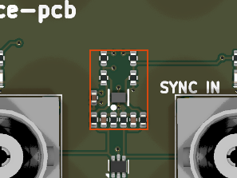

# logic_input_2ch_5v_schmitt_sn74lvc2g17

<!-- Generated by orb-weaver-kicad-board-docs from board-manifest.yaml; do not edit. -->

Block `orb_weaver_private:logic_input_2ch_5v_schmitt_sn74lvc2g17` placed in `/inputs` of **camera-gpio-interface-pcb**. Two-channel single-ended logic input conditioner: per-channel series/RC filtering plus an SN74LVC2G17 dual Schmitt-trigger buffer that turns a 3.3 V or 5 V field-wired logic signal into clean 3.3 V logic, with a 100 ohm InstrumentPort tap on each output.

|  |  |
| --- | --- |
| Lifecycle | routed |
| Family | none (a private block) |
| Placement | anchor (-12, 17) mm, rotation 90°, front side |
| Sheet | `logic_input_2ch_5v_schmitt_sn74lvc2g17.kicad_sch`; sheet pins: the board's own arrangement |
| Drawing | [camera-gpio-interface-pcb-inputs-logic_input_2ch_5v_schmitt_sn74lvc2g17.svg](../schematic/camera-gpio-interface-pcb-inputs-logic_input_2ch_5v_schmitt_sn74lvc2g17.svg) |

## On the Board

Block 7 of the [board view](../board-view.md): 5.9 × 8.1 mm on the top side, its centre 12.0 mm left of and 16.1 mm below the board centre (X right, Y up, as the enclosure tables); 12 footprints. The picture is the top render clipped around the block, the rectangle the extent of its footprints' courtyards.

## Description

Two-channel single-ended logic input conditioner: per-channel series/RC filtering plus an SN74LVC2G17 dual Schmitt-trigger buffer that turns a 3.3 V or 5 V field-wired logic signal into clean 3.3 V logic, with a 100 ohm InstrumentPort tap on each output. Generic sibling of quadrature_encoder_input_5v_sn74lvc2g17: same circuit and values, generic names, no encoder-supply passthrough. Use this one for BNC trigger and sync inputs, sensor and switch logic lines and any other pair of inputs a board conditions; use the encoder block when the harness also carries the encoder supply; place this block twice for four inputs. Connector-agnostic: the jack or terminal lives on the board sheet. Bring the raw lines in on IN_A_RAW and IN_B_RAW, take conditioned 3.3 V logic out on IN_A and IN_B and the taps out on IN_A_INST and IN_B_INST; rails +3.3V and GND.
Per channel: R41003/R41004 4.7 kohm series (OW-RES-4K7-0402, C25900) into C41001/C41002 470 pF C0G to ground (OW-CAP-470P-0402-C0G-100V, C1518202) and U41001 SN74LVC2G17DRYR gate A/B (OW-MISC-SN74LVC2G17DRYR, C2675856); R41001/R41002 100 kohm pull-down (OW-PASS-RC0402JR-07100KL, C106234) on the harness side of the series resistor, so an unplugged input reads low without forming a divider that eats VIH margin; R41005/R41006 100 kohm pull-down on each output for Ioff high-Z, so an always-on downstream buffer never sees a floating input when this rail is down; R41007/R41008 100 ohm T-taps (OW-PASS-0402WGF1000TCE, C25076) to the _INST ports, INSTRUMENT netclass from the instrument-taps profile; C41003 100 nF (OW-CAP-100N-0402-X5R-16V, C162178) hard against U41001 pin 5.
The Schmitt input is the point of the block: an ordinary LVC buffer specifies a maximum input transition rate of about 8 ns/V, which a slow or noisy field edge violates and double-triggers; the 2G17 has no such limit and 0.4 V minimum hysteresis at 3 V. Thresholds VT+ <= 2.0 V and VT- >= 0.8 V, so a 3.3 V microcontroller pin clears the high threshold by 0.9 V or more and a 5 V TTL-level VOH of 2.4 V by 0.4 V.
Tolerance: inputs are rated 0 to 5.5 V at any valid VCC, 6.5 V absolute maximum, with no clamp diode to VCC, so a 5 V source plugged in by mistake is legal; a source held below ground draws about 0.2 mA per volt through the 4.7 kohm (a -5 V DAC output about 1 mA), and a short to a 36 V rail is bounded to about 7 mA and destroys a 0.19 USD buffer instead of the consumer.
Filter: 4.7 kohm and 470 pF give a 72 kHz corner and about 2 us from a 3.3 V edge to the Schmitt threshold, the same on both channels so their relative timing is preserved; 470 pF suits sub-10 kHz timing edges on long unshielded leads, swap C41001/C41002 for a faster corner when the signal needs it (27 pF gives 1.25 MHz).
Rails are generic labels: bind +3.3V to the always-on rail when the taps must be observable before firmware runs, or to the switched domain when the consumer of IN_A/IN_B can be powered down and must rise and fall with it; sequencing between source and buffer is a non-issue because Ioff disables the outputs when the part is unpowered.
First consumer: camera-gpio-interface-pcb, TRIG IN and SYNC IN BNCs from a pyControl breakout on IN_A_RAW/IN_B_RAW, TRIG_IN/SYNC_IN out, taps on DIG0/DIG1 of the digital-50 InstrumentPort.
Series resistors and filter capacitors on the input edge, the 2G17 and its decoupling in the middle, output pull-downs and taps on the output edge, so harness-side nets stay on one edge and logic and tap nets leave on the other. Keep the input pair away from motor bridge outputs and give it a ground reference.
Project-local pending bench verification; promotable once a second board uses it.

## Ports

The brief's shape, edge, class and meaning for each port, then what the board wires it to.

| Port | Shape | Edge | Class | Wired to | Board net | Board class | GPIO | Meaning | On this board |
| --- | --- | --- | --- | --- | --- | --- | --- | --- | --- |
| `+3.3V` | passive | west | PWR_3V3_LOCAL | `+3.3V` | `/+3.3V` | PWR_3V3_NARROW |  | Buffer supply (VCC, pin 5), 1.65 to 5.5 V; always-on when the taps must be observable before firmware runs, switched when the consumer of IN_A/IN_B powers down with it (Ioff keeps the unpowered outputs off the bus). |  |
| `GND` | passive | west | PWR_RETURN_LOCAL | `GND` | `/GND` | PWR_RETURN_LOCAL |  | Return for the buffer (pin 2), both filter capacitors and the four pull-downs. |  |
| `IN_A` | output | east | Default | `TRIG_IN` | `/TRIG_IN` | Default |  | Conditioned channel A, 3.3 V logic from 1Y (pin 6); pulled down by R41005 when the rail is off. |  |
| `IN_A_INST` | output | east | INSTRUMENT | `TRIG_IN_INST` | `/TRIG_IN_INST` | INSTRUMENT |  | Instrument tap of IN_A through R41007 (100 ohm), INSTRUMENT class. |  |
| `IN_A_RAW` | input | west | Default | `TRIG_RAW` | `/inputs/TRIG_RAW` | Default |  | Field-wired channel A input, 0 to 5.5 V legal at any VCC; pulled low by R41001 (100 k) when unplugged. |  |
| `IN_B` | output | east | Default | `SYNC_IN` | `/SYNC_IN` | Default |  | Conditioned channel B, 3.3 V logic from 2Y (pin 4); pulled down by R41006 when the rail is off. |  |
| `IN_B_INST` | output | east | INSTRUMENT | `SYNC_IN_INST` | `/SYNC_IN_INST` | INSTRUMENT |  | Instrument tap of IN_B through R41008 (100 ohm), INSTRUMENT class. |  |
| `IN_B_RAW` | input | west | Default | `SYNC_RAW` | `/inputs/SYNC_RAW` | Default |  | Field-wired channel B input, 0 to 5.5 V legal at any VCC; pulled low by R41002 (100 k) when unplugged. |  |

## Parts

As placed on the board's sheet; 12 of 12 paired with the brief's references by symbol identity, the rest given the brief's role where the internal part has one, else the catalog's role slug; the placement is the `Placement` field of the board's symbol, else of the library's (D38).

| Reference | Brief | Part | Value | Role | Placement |  |
| --- | --- | --- | --- | --- | --- | --- |
| `C1101` | `C41001` | `OW-CAP-470P-0402-C0G-100V` | 470pF | Input low-pass capacitor, 72 kHz with 4.7 k | beside U1101A.1 (1A), on IN_A_FILT |  |
| `C1102` | `C41002` | `OW-CAP-470P-0402-C0G-100V` | 470pF | Input low-pass capacitor, 72 kHz with 4.7 k | beside U1101B.3 (2A), on IN_B_FILT |  |
| `C1103` | `C41003` | `OW-CAP-100N-0402-X5R-16V` | 100nF | VCC bypass for U41001 | beside U1101C.5 (VCC), on +3.3V |  |
| `R1101` | `R41001` | `OW-PASS-RC0402JR-07100KL` | 100k | Input idle-low pull-down, 100 k |  |  |
| `R1102` | `R41002` | `OW-PASS-RC0402JR-07100KL` | 100k | Input idle-low pull-down, 100 k |  |  |
| `R1103` | `R41003` | `OW-RES-4K7-0402` | 4.7k | Input series filter resistor, 4.7 k |  |  |
| `R1104` | `R41004` | `OW-RES-4K7-0402` | 4.7k | Input series filter resistor, 4.7 k |  |  |
| `R1105` | `R41005` | `OW-PASS-RC0402JR-07100KL` | 100k | Output pull-down, unpowered state | beside U1101A.6 (1Y), on IN_A |  |
| `R1106` | `R41006` | `OW-PASS-RC0402JR-07100KL` | 100k | Output pull-down, unpowered state | beside U1101B.4 (2Y), on IN_B |  |
| `R1107` | `R41007` | `OW-PASS-0402WGF1000TCE` | 100 | Instrument tap series resistor |  |  |
| `R1108` | `R41008` | `OW-PASS-0402WGF1000TCE` | 100 | Instrument tap series resistor |  |  |
| `U1101` | `U41001` | `OW-MISC-SN74LVC2G17DRYR` | SN74LVC2G17DRYR | Schmitt-trigger buffer |  |  |

## Operating Notes

- Signal path, per channel: IN_A_RAW -> R41003 (4.7 k) -> IN_A_FILT (C41001 470 pF to GND) -> U41001 1A (pin 1) -> 1Y (pin 6) -> IN_A, tapped through R41007 (100 ohm) to IN_A_INST; channel B is R41004, C41002, 2A (pin 3), 2Y (pin 4), IN_B and R41008 to IN_B_INST. R41001/R41002 (100 k) pull the raw inputs low when unplugged, on the harness side of the series resistor so no divider eats VIH margin; R41005/R41006 (100 k) define the outputs when +3.3V is off.
- Filter: 4.7 k and 470 pF give a time constant of about 2.2 us and a corner near 72 kHz; a 3.3 V edge reaches the worst-case VT+ of 2.0 V about 2 us later, the same on both channels, so relative timing is kept. For faster edges swap C41001/C41002 (27 pF gives about 1.25 MHz).
- The Schmitt input is the point: at VCC = 3 V, VT+ is 1.3 to 2.0 V and VT- 0.8 to 1.3 V with at least 0.4 V of hysteresis, so slow or noisy field edges cannot double-trigger; a 3.3 V source clears VT+ by at least 1.3 V, a 5 V TTL VOH of 2.4 V by 0.4 V. Inputs are rated 0 to 5.5 V at any VCC (6.5 V absolute), so a 5 V source is legal; a source below ground draws about 0.2 mA per volt through the 4.7 k (about 1 mA from -5 V), and a short to 36 V is bounded to about 7 mA into the buffer.
- Supply: VCC 1.65 to 5.5 V, 10 uA max, +/-24 mA drive at 3 V; Ioff (10 uA max) keeps the outputs off a live downstream input when the rail is down, which is why the sequencing between source and buffer does not matter. C41003 (100 nF) bypasses pin 5.

## Placement and Routing

### Channel A input filter

`R41001`, `R41003`

R41003 in series with the raw input into C41001 to GND forms the 72 kHz low-pass at 1A; R41001 holds IN_A_RAW low when nothing is plugged in.

- Place: Series resistors and filter capacitors on the input edge of the block, C41001 with a short return to GND at the buffer's pin 2 side; keep the raw pair away from motor bridge outputs with a ground reference beside it.
- Route: IN_A_RAW and IN_B_RAW enter as tracks (harness side); IN_A_FILT stays inside the block.

### Channel B input filter

`R41002`, `R41004`

The same network for channel B into 2A; R41002 holds IN_B_RAW low when unplugged.

- Place: Mirror channel A on the input edge so both channels see the same copper and the same delay.
- Route: IN_B_FILT stays inside the block.

### Output pull-downs and instrument taps

`R41007`, `R41008`

R41005/R41006 (100 k) define IN_A/IN_B while the buffer is unpowered; R41007/R41008 (100 ohm) are the series taps to IN_A_INST and IN_B_INST.

- Place: Output pull-downs and taps on the output edge, so logic and tap nets leave on the side opposite the harness.
- Route: IN_A, IN_B, IN_A_INST and IN_B_INST leave through vias (port copper); the taps carry the INSTRUMENT class, the two tap stubs are 0.15 mm.

### Schmitt buffer and supply bypass

`U41001`, `C41003`, `C41001`, `C41002`, `R41005`, `R41006`

U41001 gates A (1A to 1Y) and B (2A to 2Y) square the filtered inputs into 3.3 V logic; C41003 (100 nF) bypasses VCC (pin 5) to GND (pin 2).

- Place: U41001 in the middle of the block between the input and output edges, C41003 hard against pin 5 with a short return to pin 2; +3.3V and GND reach the block through vias.
- Route: +3.3V carries PWR_3V3_LOCAL; the block's baseline is 0.2 mm tracks and 0.6/0.3 mm vias.

## Library Identity

|  |  |
| --- | --- |
| Block | `orb_weaver_private:logic_input_2ch_5v_schmitt_sn74lvc2g17` |
| Resolution | the placed id is in the library |
| Brief | `design_blocks/orb_weaver_private.kicad_blocks/logic_input_2ch_5v_schmitt_sn74lvc2g17.kicad_block/logic_input_2ch_5v_schmitt_sn74lvc2g17.brief.yaml`, the block's brief |
| Published sheet | `eb3efe0db8c09f06` |
| Published PCB | `75189b4603e8f8c5` |
| Source lock | symbol snapshot `d0f8273d1ebeb5a2`, published 2026-10-14 |
| Placed sheet | `768774d53281c846`: differs from the library's sheet; parts: the brief’s 12 by internal part; ports: the brief's |
| Netlist check | not run (`--brief-check`, kicad-cli) |

