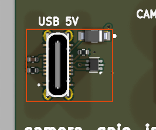

# usb2_vertical

<!-- Generated by orb-weaver-kicad-board-docs from board-manifest.yaml; do not edit. -->

Block `orb_weaver_private:usb2_vertical` placed in `/power` of **camera-gpio-interface-pcb**. USB-C USB2 device-port front end on a VERTICAL, top-entry receptacle: GCT USB4145-03-0070-C, OW-CONN-USB-C-USB2-SMD-VERT, 16P USB2-only, SMT contacts plus four through-hole shell legs, 7.46 mm tall.

|  |  |
| --- | --- |
| Lifecycle | routed |
| Family | none (a private block) |
| Placement | anchor (-44, -1) mm, rotation 90°, front side |
| Sheet | `usb2_vertical.kicad_sch`; sheet pins: the library's arrangement |
| Drawing | [camera-gpio-interface-pcb-power-usb2_vertical.svg](../schematic/camera-gpio-interface-pcb-power-usb2_vertical.svg) |

## On the Board

Block 6 of the [board view](../board-view.md): 11.9 × 10.1 mm on the top side, its centre 42.5 mm left of and 1.0 mm above the board centre (X right, Y up, as the enclosure tables); 6 footprints. The picture is the top render clipped around the block, the rectangle the extent of its footprints' courtyards.

## Description

USB-C USB2 device-port front end on a VERTICAL, top-entry receptacle: GCT USB4145-03-0070-C, OW-CONN-USB-C-USB2-SMD-VERT, 16P USB2-only, SMT contacts plus four through-hole shell legs, 7.46 mm tall. Electrically identical to the horizontal usb2 block: USBLC6-2P6 ESD clamp on D+/D- and VBUS, 5.1k Rd pulldowns on CC1 (A5) and CC2 (B5) declaring a sink, 100nF on VBUS, a MBR120VLSFT1G series Schottky from VBUS to +5V_USB for diode-ORing with other 5 V sources (pair it with pycontrol_behavior_port_rj45's +5V_PYC), PWR_FLAG on VBUS, SBU1/SBU2 deliberately unconnected, all four shell pads S1-S4 tied to GND. Ports are VBUS, +5V_USB, GND, USB_D+, USB_D-.
Nothing reads the CC advertisement, so budget the load against a default-power source unless the host is known to advertise 1.5 A or 3 A.
Only the land pattern differs from usb2, and it differs completely, which is why this is a separate block and not a footprint swap: contacts sit in two rows on OPPOSITE sides of the body at y = +/-1.485, 0.5 mm pitch across the six inner contacts and 1.5 mm out to the outer pads, and EVERY pad is 0.3 mm wide, where the horizontal GT-USB-7047C merges A and B into one row and gives VBUS and GND 0.6 mm pads. Three consequences follow for the layout. The A/B ties are the layout's work: D+ (A6/B6) and D- (A7/B7) cross at the body centre and cannot be taken around the ends, because the 0.3 mm gap between the outer contact and the shell-leg pad is unroutable at 0.2/0.2 and the plated leg blocks every layer there, so budget one via jump for one leg of the pair and keep both legs equal length. VBUS lands on four 0.3 mm pads (A4/A9/B4/B9) and GND on four (A1/A12/B1/B12): use all four of each in parallel for the 3 A rating and drop their ties to an inner layer rather than crowding the 1.8 mm corridor between the rows, which the two data joins need. The four shell legs are plated ovals on a 1.1 x 0.6 drill at x = +/-4 and punch every layer, and the two 0.71 mm NPTH locator pegs at (+/-4, 0) are mandatory for seating: place all six before pouring GND or routing the port.
Mechanically the courtyard shrinks to x +/-5.05, y +/-2.31 from the horizontal part's x +/-6.00, y -1.25 to +6.75, so the connector stops needing about 6.75 mm of board past the contacts and can move inboard, but the cable now leaves perpendicular to the board: the enclosure needs an aperture above it plus clearance for the plug body and its wire loop, well beyond the 7.46 mm connector height.
Keep the USBLC6 hard against the receptacle with a ground via at its pin 2 and route each data line in one I/O pad and out the other (clamp performance is dominated by connection inductance), and bring USB_D+/USB_D- to the block boundary already coupled at the USB_HS netclass gap. +5V_USB leaves D31001 pad 1 into a port via, where a placing board picks the rail up.

## Ports

The brief's shape, edge, class and meaning for each port, then what the board wires it to.

| Port | Shape | Edge | Class | Wired to | Board net | Board class | GPIO | Meaning | On this board |
| --- | --- | --- | --- | --- | --- | --- | --- | --- | --- |
| `+5V_USB` | passive | east | Default | `+5V` | `/+5V` | PWR_5V_NARROW |  | VBUS through D31001 (Schottky, about 0.3 V drop) for diode-ORing with +5V_PYC. |  |
| `GND` | passive | east | PWR_RETURN_LOCAL | `GND` | `/GND` | PWR_RETURN_LOCAL |  | USB ground: J31001 A1, B1, A12, B12 and shell S1 to S4; clamp and Rd return. |  |
| `USB_D+` | bidirectional | east | USB_HS | open: no-connect flag |  |  |  | USB 2.0 D+, J31001 A6 and B6, after the U31001 clamp; USB_HS pair with USB_D-. |  |
| `USB_D-` | bidirectional | east | USB_HS | open: no-connect flag |  |  |  | USB 2.0 D-, J31001 A7 and B7, after the U31001 clamp; USB_HS pair with USB_D+. |  |
| `VBUS` | passive | east | Default | open: no-connect flag |  |  |  | Raw bus 5 V, J31001 A4, A9, B4, B9; bypassed by C31001, the clamp's reference. |  |

## Parts

As placed on the board's sheet; 6 of 6 paired with the brief's references by symbol identity, the rest given the brief's role where the internal part has one, else the catalog's role slug; the placement is the `Placement` field of the board's symbol, else of the library's (D38).

| Reference | Brief | Part | Value | Role | Placement |  |
| --- | --- | --- | --- | --- | --- | --- |
| `C901` | `C31001` | `OW-CAP-100N-0402-X5R-16V` | 100nF | VBUS bypass at the clamp | beside U901.5 (VBUS), on VBUS |  |
| `D901` | `D31001` | `OW-MISC-MBR120VLSFT1G` | MBR120VLSFT1G | Diode-OR Schottky | beside U901.5 (VBUS), on VBUS |  |
| `J901` | `J31001` | `OW-CONN-USB-C-USB2-SMD-VERT` | USB-C | usb-connector |  |  |
| `R901` | `R31001` | `OW-PASS-ERJ2GEJ512X` | 5.1k | CC Rd sink pulldowns |  |  |
| `R902` | `R31002` | `OW-PASS-ERJ2GEJ512X` | 5.1k | CC Rd sink pulldowns |  |  |
| `U901` | `U31001` | `OW-MISC-USBLC6-2P6` | USBLC6-2P6 | ESD clamp on D+, D- and VBUS |  |  |

## Operating Notes

- Signal path: J31001 D+ (A6, B6) and D- (A7, B7) pass U31001's I/O pads to USB_D+ and USB_D-; both receptacle rows are tied so either plug orientation works. SBU1 and SBU2 (A8, B8) are no-connect: USB2 only, for an RP2040-class device controller.
- CC: R31001 on CC1 (A5) and R31002 on CC2 (B5), 5.1 k to GND, declare a UFP (sink). Nothing reads the CC level, so budget the load against a default-power source unless the host is known to advertise 1.5 A or 3 A.
- ESD: U31001 (USBLC6-2P6) clamps D+, D- and VBUS: 3.5 pF max per line, 1.7 pF max line to line, 6 V minimum VBUS breakdown, 12 V typical clamp at 1 A 8/20 us, IEC 61000-4-2 level 4 (15 kV air and contact). Clamp performance is set by connection inductance: pin 2 to a ground via, each data line in one I/O pad and out the other.
- VBUS: C31001 (100 nF) bypasses the raw bus; D31001 (MBR120VLSFT1G, 20 V 1 A Schottky, 0.34 V max at 1 A, 0.6 mA leakage at 25 C) makes +5V_USB for diode-ORing with the pyControl block's +5V_PYC. The shell pads S1 to S4 are tied to GND here; isolate them through a pad/cap network instead if the shield must float.
- Land pattern (from the block's own record): contacts in two rows on opposite sides of the body at 0.5 mm pitch, every pad 0.3 mm wide; the A/B ties for D+ and D- cross at the body centre with one via jump per pair leg and equal lengths; VBUS and GND each land on four pads to be used in parallel for the 3 A rating. Four plated shell legs and two 0.71 mm locator pegs are mandatory for seating. The cable leaves perpendicular to the board (7.46 mm connector height), so the enclosure needs an aperture above it.

## Placement and Routing

### Receptacle and ESD clamp

`J31001`, `U31001`, `D31001`, `C31001`

J31001 brings VBUS, GND, D+/D-, CC1/CC2 and the shell onto the board; U31001 clamps USB_D+, USB_D- and VBUS to GND right at the receptacle. C31001 holds the raw VBUS node at the clamp; D31001 passes VBUS to +5V_USB and blocks the other 5 V source from feeding back into the host.

- Place: Place U31001 hard against J31001 with a ground via at its pin 2; route each data line in one I/O pad and out the other.
- Place: Place J31001's four shell-leg holes and two locator pegs before pouring GND or routing the port; the part does not seat without them.
- Place: Place C31001 between U31001 pin 5 and the GND via; D31001 sits where +5V_USB leaves the block at its port via.
- Route: USB_D+ and USB_D- are the USB_HS pair: equal length, coupled at the class gap, brought to the block boundary already coupled.
- Route: Jump one leg of each pair once at the body centre for the A/B tie; the 0.3 mm gap at the outer contacts is unroutable.
- Route: VBUS and +5V_USB are Default-class rails for the port's 5 V budget; +5V_USB is picked up at the port via by the placing board.

### CC sink declaration

`R31001`, `R31002`

R31001 and R31002 (5.1 k) pull CC1 and CC2 to GND: the port presents itself as a sink; nothing reads the source's advertisement.

- Place: Keep R31001 at A5 and R31002 at B5 with short returns; no other load on CC1 or CC2.
- Route: CC1 and CC2 are Default-class local nets that end at the resistors.

## Library Identity

|  |  |
| --- | --- |
| Block | `orb_weaver_private:usb2_vertical` |
| Resolution | the placed id is in the library |
| Brief | `design_blocks/orb_weaver_private.kicad_blocks/usb2_vertical.kicad_block/usb2_vertical.brief.yaml`, the block's brief |
| Published sheet | `938d8c968797018e` |
| Published PCB | `55ced031728de451` |
| Source lock | symbol snapshot `40ea67778de8e7b1`, published 2026-10-14 |
| Placed sheet | `cf27bc17c1a4211a`: differs from the library's sheet; parts: the brief’s 6 by internal part; ports: the brief's |
| Netlist check | not run (`--brief-check`, kicad-cli) |

