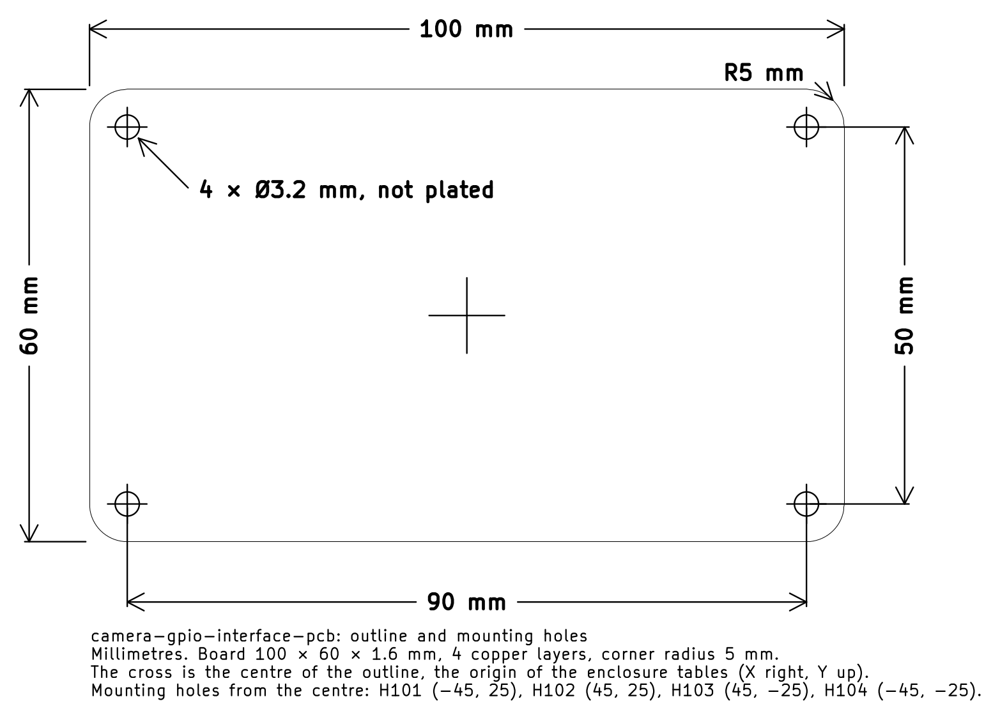

# camera-gpio-interface-pcb Board Dimensions

Generated by `export_board_geometry.py`. Do not edit by hand.

All coordinates are millimetres in a right-handed frame whose **origin is the
centre of the board outline**, with **X to the right and Y up** when looking at
the top of the board. This is the frame mechanical CAD wants; it is not KiCad's.
The frame origin sits at KiCad coordinates (150.0, 95.0).

## Drawing

The outline and the mounting holes dimensioned, plotted by KiCad from a copy of the board with the dimensions on its `Dwgs.User` layer: [SVG](board-dimensions.svg) · [PDF](board-dimensions.pdf) (the PDF is the board's page, 1:1 when printed at 100 %). The cross is the centre of the outline, the origin of the tables below.

## Outline

| Property | Value |
| --- | --- |
| Shape | rounded rectangle |
| Width (X) | 100.0 mm |
| Height (Y) | 60.0 mm |
| Corner radius | 5.0 mm |
| X extent | -50.0 mm to 50.0 mm |
| Y extent | -30.0 mm to 30.0 mm |
| Board thickness | 1.6 mm |
| Copper layers | 4 |

## Stackup

| Layer | Type | Thickness (mm) | Material |
| --- | --- | --- | --- |
| F.SilkS | Top Silk Screen |  |  |
| F.Paste | Top Solder Paste |  |  |
| F.Mask | Top Solder Mask | 0.01 |  |
| F.Cu | copper | 0.035 |  |
| dielectric 1 | core | 0.48 | FR4 |
| In1.Cu | copper | 0.035 |  |
| dielectric 2 | prepreg | 0.48 | FR4 |
| In2.Cu | copper | 0.035 |  |
| dielectric 3 | core | 0.48 | FR4 |
| B.Cu | copper | 0.035 |  |
| B.Mask | Bottom Solder Mask | 0.01 |  |
| B.Paste | Bottom Solder Paste |  |  |
| B.SilkS | Bottom Silk Screen |  |  |

## Mounting Holes

| Ref | X (mm) | Y (mm) | Drill (mm) | Plated |
| --- | ---: | ---: | ---: | --- |
| H101 | -45.0 | 25.0 | 3.2 | no |
| H102 | 45.0 | 25.0 | 3.2 | no |
| H103 | 45.0 | -25.0 | 3.2 | no |
| H104 | -45.0 | -25.0 | 3.2 | no |

Unplated holes that belong to a connector or switch rather than to the
enclosure. They are drilled in the board but need no enclosure hardware.

| Ref | X (mm) | Y (mm) | Drill (mm) |
| --- | ---: | ---: | ---: |
| J901 | -44.0 | -3.0 | 0.71 |
| J901 | -44.0 | 5.0 | 0.71 |

## Connectors and Controls

`X` and `Y` are the footprint origin. The courtyard columns are the part's
keep-clear rectangle in the same frame, which is what a panel cutout needs.

| Ref | Value | Side | X (mm) | Y (mm) | Rot | Courtyard X | Courtyard Y |
| --- | --- | --- | ---: | ---: | ---: | --- | --- |
| J301 | HL-BNC-KHDA | top | -24.0 | -23.0 | 0 | -30.5 to -17.5 | -29.5 to -16.5 |
| J302 | HL-BNC-KHDA | top | 0.0 | -23.0 | 0 | -6.5 to 6.5 | -29.5 to -16.5 |
| J401 | HL-BNC-KHDA | top | 24.0 | -23.0 | 0 | 17.5 to 30.5 | -29.5 to -16.5 |
| J402 | HL-BNC-KHDA | top | -24.0 | 1.0 | 0 | -30.5 to -17.5 | -5.5 to 7.5 |
| J403 | HL-BNC-KHDA | top | 0.0 | 1.0 | 0 | -6.5 to 6.5 | -5.5 to 7.5 |
| J404 | HL-BNC-KHDA | top | 24.0 | 1.0 | 0 | 17.5 to 30.5 | -5.5 to 7.5 |
| J501 | FH12-50S-0.5SVA(54) | top | 44.0 | -4.0 | 270 | 41.2 to 46.8 | -18.75 to 10.75 |
| J701 | TBH-1x06-3.5mm | top | -25.0 | 24.0 | 180 | -36.7 to -13.3 | 19.25 to 27.5 |
| J901 | USB-C | top | -44.0 | 1.0 | 90 | -46.31 to -41.69 | -4.05 to 6.05 |
| J1201 | TBH-1x06-3.5mm | top | 0.0 | 24.0 | 180 | -11.7 to 11.7 | 19.25 to 27.5 |
| J1401 | TBH-1x06-3.5mm | top | 25.0 | 24.0 | 180 | 13.3 to 36.7 | 19.25 to 27.5 |
